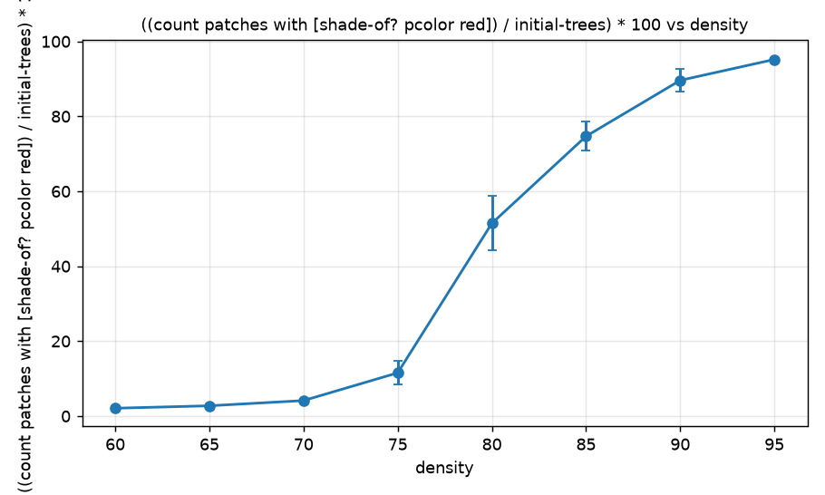
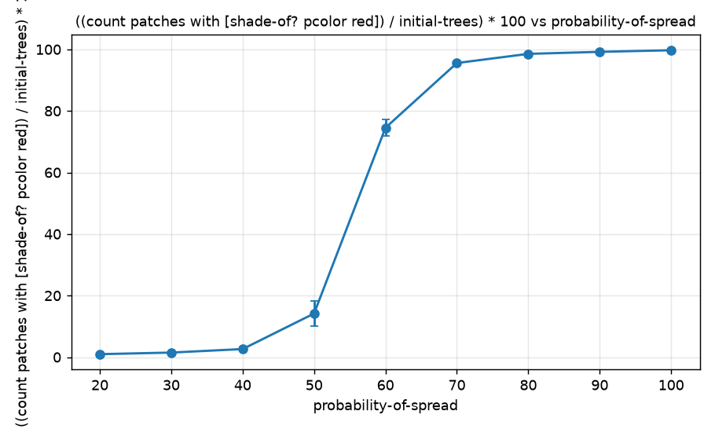
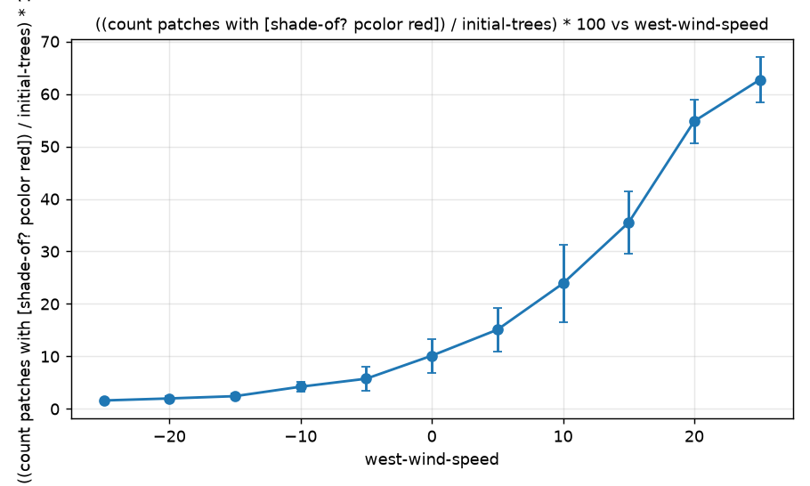
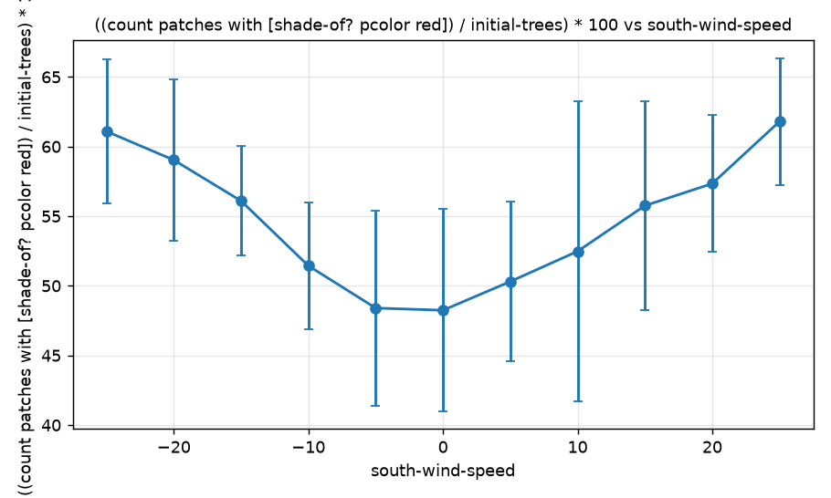

# Комп'ютерні системи імітаційного моделювання

## СПм-25-2, **Лебідь Іван Сергійович**

### Лабораторна робота №**1**. Опис імітаційних моделей та проведення обчислювальних експериментів

 

### Варіант 5, модель у середовищі NetLogo:
[Fire Simple Extension 2](http://www.netlogoweb.org/launch#http://www.netlogoweb.org/assets/modelslib/IABM%20Textbook/chapter%203/Fire%20Extensions/Fire%20Simple%20Extension%202.nlogo)

 

### Вербальний опис моделі:
Проста модель поширення лісової пожежі з урахуванням вітру. Ліс - це поле 251 × 251 ділянка (без замикання по краях), на якому кожна ділянка з ймовірністю `density` % стає деревом (зелена). Пожежа починається одразу на всій лівій межі поля (стовпець червоних ділянок) і поширюється на чотири сусідні ділянки (північ, схід, південь, захід). Кожне палаюче дерево (червона ділянка) лише один такт «підпалює» сусідів, а потім перетворюється на згоріле (темно-червоне).

Імовірність підпалу сусідського дерева дорівнює `probability-of-spread`, але змінюється вітром: вітер, що дме *від* палаючого дерева до сусіднього, збільшує імовірність, а *проти* - зменшує на величину швидкості вітру. Окремо діють «південний» (`south-wind-speed`, додатне значення - вітер з півдня на північ) і «західний» (`west-wind-speed`, додатне значення - вітер із заходу на схід) вітри; від'ємні значення означають протилежні напрямки. Модель показує, що ймовірність того, що пожежа дійде до протилежного краю, критично залежить від щільності лісу: існує поріг, нижче якого вогонь затухає.

### Керуючі параметри (повзунки):
- **density** - щільність лісу, % (0-100, за замовчуванням 82). Зміна впливає лише після наступного `setup`.
- **probability-of-spread** - базова імовірність передачі вогню сусідньому дереву за такт, % (0-100, за замовчуванням 57).
- **south-wind-speed** - швидкість південного вітру (-25…25, за замовчуванням 25). Від'ємні значення - північний вітер.
- **west-wind-speed** - швидкість західного вітру (-25…25, за замовчуванням 25). Від'ємні значення - східний вітер.

### Внутрішні параметри:
- **initial-trees** (глобальна змінна) - кількість дерев (зелених ділянок) на момент початку симуляції, без стовпця палаючих ділянок.
- **колір ділянки** (`pcolor`) - єдиний стан ділянки: зелений (дерево), червоний (палає), темно-червоний `red - 3.5` (згоріла), чорний (порожня ділянка).
- Імовірність підпалу для кожної пари «палаюче дерево - сусіднє дерево» обчислюється як `probability-of-spread ± швидкість вітру` залежно від напрямку (значення може вийти за межі 0-100, тоді це означає «ніколи» або «завжди»).

### Показники роботи системи:
- **percent burned** - відсоток згорілих дерев (монітор): кількість ділянок червоного відтінку (палаючі та згорілі) ділиться на `initial-trees` і множиться на 100.
- Кількість тактів `ticks` до згасання пожежі (час горіння), модель зупиняється, коли не залишається палаючих ділянок.

### Алгоритм зміни стану моделі:
**setup:** кожна ділянка з ймовірністю `density` % стає деревом; усі ділянки лівого стовпця стають палаючими; підраховується `initial-trees`.  
**go** (щотакту): якщо палаючих ділянок немає - зупинка. Інакше кожна палаюча ділянка:
1. для кожного зеленого сусіда (4 напрямки) обчислює імовірність підпалу: `probability-of-spread` плюс швидкість вітру, якщо вітер дме від палаючого дерева до сусіда, і мінус швидкість вітру, якщо проти;
2. якщо випадкове число від 0 до 99 менше за імовірність, сусід починає горіти (стає червоним);
3. сама стає згорілою (темно-червоною).

### Примітки:
- У вкладці Info для параметра west-wind-speed помилково сказано «вітер з півдня» (насправді з заходу).
- Кожне дерево горить рівно один такт: на екрані палаючі (червоні) ділянки є лише в момент займання, далі вони стають темно-червоними.
- Розподіл дерев випадковий, тому при однакових параметрах результат від запуску до запуску відрізняється; для експериментів потрібні повтори.

### Недоліки моделі:
- Вогонь передається тільки по вертикалі й горизонталі (чотири сусіди), по діагоналі - ні.
- Час горіння дерева фіксований (один такт): немає залежності від вологості, виду дерев тощо.
- Вітер змінює імовірність лінійно та лише вздовж двох осей; діагональний або змінний у часі вітер неможливий.
- Відсоток згорілого рахується від `initial-trees`, а в чисельник потрапляє ще й початковий стовпець палаючих ділянок (він не входить у знаменник), тому значення дещо завищене (приблизно на 0,4-0,7 % залежно від щільності, бо цей стовпець містить 251 ділянку).
- Немає рельєфу, перешкод для вогню (річок, просік) та реакції на пожежу: ніхто її не гасить.
- Зміна `density` діє тільки після наступного `setup`, тож впливати на щільність під час симуляції неможливо.

 

## Обчислювальні експерименти

> **Як проводились експерименти:** використано інструмент NetLogo BehaviorSpace (вкладка Tools → BehaviorSpace). Кожне значення досліджуваного параметра запускалось по 10 разів до повного згасання пожежі (макс. 2000 тактів; усі прогони завершились раніше). Для кожного прогону фіксувалось значення `percent burned` у кінці та кількість тактів `ticks`. У таблицях наведено середнє по 10 прогонах, на графіках стандартні відхилення показані вертикальними рисками. Параметри, які в експерименті не досліджуються, мали значення за замовчуванням: density = 82, probability-of-spread = 57, south-wind-speed = 25, west-wind-speed = 25.

### 1. Вплив щільності лісу на відсоток згорілих дерев
Досліджується залежність відсотка згорілого лісу від параметра **density**. Значення: 60, 65, …, 95 % (8 значень, по 10 прогонів).  
Інші параметри мають значення за замовчуванням:
- **probability-of-spread**: 57
- **south-wind-speed**: 25
- **west-wind-speed**: 25

| density | percent burned | ticks |
|:---:|:---:|:---:|
| 60 | 2,10 | 24,4 |
| 65 | 2,76 | 43,0 |
| 70 | 4,15 | 76,3 |
| 75 | 11,54 | 203,6 |
| 80 | 51,45 | 445,9 |
| 85 | 74,69 | 368,3 |
| 90 | 89,61 | 333,0 |
| 95 | 95,19 | 308,5 |

*Висновки:* поріг помітний між 75 та 80 %: до 70 % згорає лише 2-4 % лісу, а при 80 % уже ≈51 %. Далі зростання сповільнюється, і при 95 % згорає ≈95 %. Біля порогу найбільший розкид між прогонами та найдовше горіння.

### 2. Вплив базової імовірності поширення вогню
Досліджується залежність відсотка згорілого лісу від параметра **probability-of-spread**. Значення: 20, 30, …, 100 % (9 значень, по 10 прогонів).  
Інші параметри мають значення за замовчуванням:
- **density**: 82
- **south-wind-speed**: 25
- **west-wind-speed**: 25

| probability-of-spread | percent burned | ticks |
|:---:|:---:|:---:|
| 20 | 0,96 | 12,3 |
| 30 | 1,48 | 23,9 |
| 40 | 2,62 | 55,5 |
| 50 | 14,16 | 296,6 |
| 60 | 74,53 | 377,4 |
| 70 | 95,56 | 318,0 |
| 80 | 98,54 | 297,5 |
| 90 | 99,19 | 293,4 |
| 100 | 99,72 | 293,3 |

*Висновки:* тут поріг між 50 та 60 %: при 40 % і менше згорає 1-3 % лісу, при 60 % ≈75 %, а після 70 % майже весь ліс (≈96-99 %). Найбільший розкид між прогонами знову біля порогу, при 50 %.

### 3. Вплив західного вітру
Досліджується залежність відсотка згорілого лісу від параметра **west-wind-speed**. Значення: -25, -20, …, 25 (11 значень, по 10 прогонів).  
Інші параметри мають значення за замовчуванням:
- **density**: 82
- **probability-of-spread**: 57
- **south-wind-speed**: 25

| west-wind-speed | percent burned | ticks |
|:---:|:---:|:---:|
| -25 | 1,61 | 43,2 |
| -20 | 2,00 | 60,6 |
| -15 | 2,43 | 67,1 |
| -10 | 4,23 | 117,2 |
| -5 | 5,76 | 115,5 |
| 0 | 10,14 | 228,6 |
| 5 | 15,09 | 277,6 |
| 10 | 23,91 | 379,3 |
| 15 | 35,50 | 451,0 |
| 20 | 54,81 | 463,4 |
| 25 | 62,71 | 424,8 |

*Висновки:* чим сильніший західний вітер, тим більше згорає лісу: від ≈1,6 % при -25 до ≈63 % при 25. Це логічно, бо вогонь іде на схід: західний вітер його підсилює, а східний послаблює. Результат при значенні за замовчуванням (≈63 %) збігається з експериментом 1.

### 4. Вплив південного вітру (додатковий експеримент)
Досліджується залежність відсотка згорілого лісу від параметра **south-wind-speed**. Значення: -25, -20, …, 25 (11 значень, по 10 прогонів).  
Інші параметри мають значення за замовчуванням:
- **density**: 82
- **probability-of-spread**: 57
- **west-wind-speed**: 25

| south-wind-speed | percent burned | ticks |
|:---:|:---:|:---:|
| -25 | 61,09 | 412,1 |
| -20 | 59,04 | 400,1 |
| -15 | 56,10 | 403,4 |
| -10 | 51,44 | 393,9 |
| -5 | 48,40 | 379,0 |
| 0 | 48,24 | 387,4 |
| 5 | 50,31 | 393,2 |
| 10 | 52,48 | 407,7 |
| 15 | 55,76 | 412,6 |
| 20 | 57,34 | 400,7 |
| 25 | 61,80 | 406,3 |

*Висновки:* графік має форму літери «U»: мінімум (≈48 %) при відсутності південного вітру, а при сильному вітрі в будь-який бік згорає ≈61-62 %. Тобто важливий не напрямок, а сама наявність вітру вздовж осі північ-південь. Вплив слабший, ніж у західного вітру.
